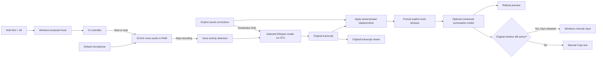
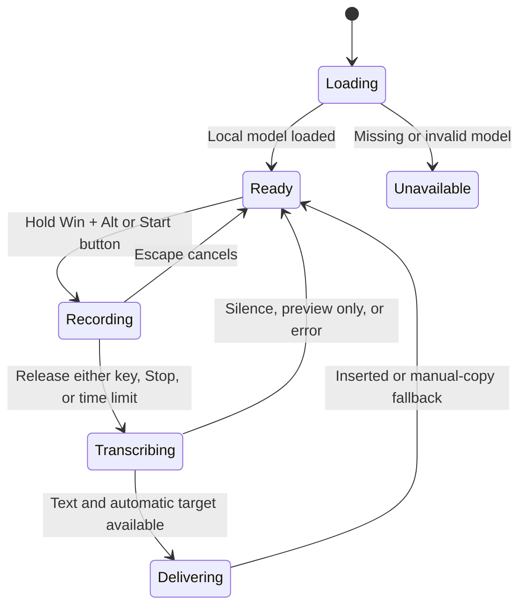

# Local Dictation: system design and logic

This is a single Windows desktop process. It has a small window and tray icon, a
global keyboard shortcut, microphone capture, and a local English speech model.
There is no application server, database, API key, or paid service in the dictation path.

## Desktop presentation and distribution

`desktop_ui.py` owns the Tk/ttk visual theme and the Dictate/Preferences layout.
`app.py` continues to own recording state, event processing, and inference. The
visual redesign adds no browser runtime or new Python dependency. Windows DPI
awareness and an explicit Tk scale keep the interface crisp and its layout stable.

The marketing website is independent static HTML/CSS/JavaScript in `website/dist`.
Its example is scripted; it never records audio. Download anchors point to the
versioned setup ZIP, and `release.json` supplies size/checksum metadata. The desktop
app never needs the website after installation.

`build_release.py` produces a deterministic ZIP from an explicit allowlist. Private
runtime files are excluded. `Setup.cmd` runs `Install.ps1`, which reuses a supported
64-bit Python or obtains a signed Python installer, creates a virtual environment,
installs pinned packages, verifies model downloads, and creates a desktop shortcut.
Initial installation uses the internet; recognition remains fully local afterward.
This is a source/setup distribution. It is not a signed standalone executable.

## Data flow



Holding both keys starts capture and remembers the foreground window.
Releasing either key stops capture and starts transcription. Text appears after processing,
not word by word during speech. The microphone is closed before transcription starts.

## Architecture and logic side by side

| Component / location | What it owns | Logic and reason |
|---|---|---|
| `launch.py`, `run.bat` | Startup | Launch the window without a console. Show startup errors and save their traceback in `startup.log`. |
| `app.py`: `App` | UI and coordination | Keep widgets on the main Tk thread. Poll the event queue every 50 ms. |
| `win_input.py`: `Hotkey`, `HoldChord` | Hold-to-talk shortcut | A keyboard hook queues `hold_start` when Win + Alt are held and `hold_end` on release. Repeats are ignored; release both keys to rearm. |
| `App.toggle`, `App.audio` | Microphone capture | Read the default microphone as 16,000 mono float32 samples per second. Append short chunks to RAM; mark dropped audio for review. |
| `App.stop`, `App.cancel` | Recording lifecycle | Stop closes the microphone and combines chunks. Escape discards the capture. A two-minute limit bounds recording memory. |
| `App.load`, `App.switch_model` | Model lifecycle | Load either base.en or small.en locally using CPU INT8 and up to four threads. Release the old speech model before loading another. Save the selected model in app_settings.json. |
| `App.transcribe`, `speech_settings.py` | Stage 1: recognition | Use faster-whisper with VAD, English, beam size 5, short punctuated transcript context, and independent utterances. Predict words and punctuation from audio. |
| `personalization.py` | Explicit personalization | Store at most 200 user-saved phrase replacements. Supply bounded preferred-spelling hints to Whisper; apply whole-phrase replacements once. No passive history or training. |
| `punctuation.py` | Stage 2: contextual punctuation | Run the 7.1 MiB INT8 Edge-Punct-Casing model using sherpa-onnx on one CPU thread. Predict punctuation from text context. Preserve words, names, short punctuated sentences and technical strings. |
| `memory_stats.py` | Live resource visibility | Read the actual Python process's working set and private commit, plus available system RAM, every three seconds. |
| `text_spacing.py` | Prose spacing and dictation boundaries | Repair missing spaces around clear sentence boundaries before and after refinement, preserving recognized technical tokens. Add an optional trailing space at insertion so successive dictations do not merge. |
| `time_formatting.py` | Clock phrase formatting | Convert explicit half-past and quarter-past/to phrases to numeric times. Validate the hour, handle the 12-hour wraparound, preserve code, and never infer a time from a sound-alike. |
| `App.poll` | Worker result handling | Display the transcript. Skip automatic insertion if audio was dropped. Update status and return to ready. |
| `App.deliver`, `win_input.insert_text` | Text delivery | Check the original window is still foreground. Wait up to three seconds for modifier keys to be released. Send UTF-16 Unicode key events; leave the clipboard unchanged. |
| `App.copy` | Compatibility fallback | Copy the visible transcript when the user clicks Copy text. This action intentionally replaces the clipboard. |
| `pystray` | Background access | Keep Open and Quit available while the main window is hidden. Show a red marker while recording. |
| `download_model.py`, `download_punctuation.py`, `setup.bat` | One-time installation | Install locked dependencies and model files over HTTPS. Verify SHA-256 before activation. Extract only the quantized punctuation model and vocabulary. |

## State and decision logic



These are conceptual states. The implementation represents them using `busy`, `stream`,
`model`, and `target`, rather than an enum. `busy` prevents overlapping transcription
requests. `stream is not None` means recording is active. `hold_recording` distinguishes
hold-to-talk from recordings started using the preview button.

```text
on hold_start:
    if busy or already recording: ignore
    otherwise: remember active window; start microphone in hold mode

on hold_end:
    if recording in hold mode: stop microphone; transcribe in worker
    otherwise: ignore

on transcript:
    retain original text in memory
    apply explicitly saved phrase corrections
    optionally refine punctuation using text context
    show text in preview
    if empty: return to ready
    if dropped audio or preview-only recording: require manual copy
    otherwise if original window changed: require manual copy
    otherwise wait for shortcut keys to be released, then insert text
```

## Concurrency

- **Main thread:** owns the window, app state, and insertion decisions.
- **Hotkey thread:** runs a Windows keyboard hook and queues hold/release events.
- **Audio callback:** receives microphone chunks; performs no speech recognition.
- **Model worker:** loads the model or transcribes a stopped recording.
- **Tray thread:** runs the tray message loop; menu actions are queued to the UI.

The queue carries events across threads. Workers do not directly edit Tk widgets.
This keeps the window usable during inference. Recording and transcription are sequential
in this version, which limits CPU and memory competition.

## Model, punctuation, and resources

Whisper base.en and optional small.en are the English speech models. Faster-whisper is the execution engine
that runs it through CTranslate2. INT8 means the engine uses reduced-precision arithmetic
to reduce inference cost. No dedicated graphics card is required by this configuration.

Stage 1 turns sound into acoustic features (a log-Mel spectrogram). Whisper's encoder
processes those features and its decoder predicts text tokens using the audio and prior
text context. Wider beam search considers more candidate token sequences. A transcript-
style initial prompt demonstrates punctuation; it is not an instruction-following chat prompt.

Stage 2 uses a small CNN/BiLSTM punctuation-and-casing model. It reads words in context,
not silence duration. It loads lazily on the first eligible text and remains available for
subsequent recordings. Its 7.1 MiB disk size does not equal total runtime RAM usage.
It processes at most 120 words per existing sentence and preserves larger spans unchanged.
URLs, email addresses, numeric punctuation and certain code-like strings are passed through.

Words are checked before accepting refinement. Existing short sentence endings are kept
because experiments showed that unnecessary reprocessing can degrade correct punctuation.
Punctuation is still imperfect. There is no general grammar rewriting, automatic list
formatter, or spoken-command parser in this version.

At 16 kHz, one float32 mono stream needs about 64 KB per second. Two minutes is about
7.7 MB of raw samples. Combining the chunks temporarily adds another copy. Model weights,
runtime libraries and inference buffers consume additional memory. The model remains
loaded while idle to improve response time.

### Measured optimization (2026-10-25)

The live old process had about 158 MiB resident RAM and 1519 MiB private commit, plus
a 5 MiB launcher. Available system RAM was only about 535 MiB at the initial snapshot.
Windows can page committed memory out, so resident RAM alone understates memory pressure.

In isolated generated-audio tests, default matrix prepacking used 1433 MiB private commit
after recognition. With `CT2_PACKED_GEMM=0`, the comparable stage used 461 MiB. With the
punctuation engine loaded and exercised it used 491 MiB private commit and 209 MiB resident
RAM. The old and new isolated tests used beam size 3; production now uses beam size 5,
and the GUI has additional overhead. See `validation.json` for the production-pipeline
snapshot. These are observations, not fixed memory limits.

The engine documents prepacking as a speed optimization. Disabling it trades that
optimization for lower memory here. Single-sample timings varied; they do not establish
a general speed improvement. There is no smaller speech model or accuracy-reducing
quantization change in this adjustment.

### Optional accuracy model measurements

The next-size English model is now available as Accuracy mode. On the same generated
5.02-second train sentence, base.en took 1.39 seconds and small.en took 2.92 seconds.
Both recognized "half past eight" correctly; the explicit time-formatting stage produced
"8:30". This clean synthetic fixture did not reproduce the user's recognition error,
so it does not establish that the original recording is fixed.

After three generated speech samples, the isolated small.en process used about 346 MiB
resident RAM and 663 MiB private commit, with a 686 MiB peak resident set during loading.
Base.en used about 173 MiB resident and 462 MiB committed in the comparable test.
The desktop UI and punctuation model add overhead. Timings vary with other applications.
Only one speech model is retained; switching frees the previous model first, although
the runtime may retain some reusable allocation buffers.

## Storage and privacy

| Data | Location and lifetime |
|---|---|
| Model and tokenizer | `models/base.en`, persistent local files |
| Optional accuracy model | `models/small.en`, persistent local files, about 484 MB for weights |
| Selected speech model | `app_settings.json`, preference only, no transcripts |
| Punctuation model | `models/punctuation`, persistent local files |
| Explicit corrections | `personal_dictionary.json`, created only on a user save; editable/deletable in the app |
| Python libraries | `.venv`, persistent local files |
| Microphone audio | RAM during capture and processing; no recording files are written by the app |
| Last original and refined transcript | App memory and preview until replaced or the app exits; no automatic history |
| Inserted text | The destination application controls its storage |
| Manually copied text | Windows clipboard, managed by Windows and other applications |
| Startup failure | Exception traceback in `startup.log` |
| Validation artifacts | Generated test audio in `tests/sample.wav` and results in `validation.json` |

Internet is used for setup downloads. Runtime loads a local model path with
`local_files_only=True`. The validation run also set `HF_HUB_OFFLINE=1`; a physical
network-disconnection trial remains a useful manual check.

## Verified behavior and current boundaries

On this PC, the generated 5.82-second English sample transcribed in 1.66 seconds:

> Hello, this is a test of offline dictation. Can you hear me clearly?

This is a synthetic-speech smoke test, not an accuracy or latency guarantee for a human
speaker. Model loading, keyboard hook installation, insertion into the test editor, silent
audio handling, and unit checks for Unicode and changed-window protection passed.
The user has confirmed the earlier hold-to-talk version works with their voice.
The new refinement and personalization still need their real-world feedback.

Win + Alt is the implemented hold-to-talk shortcut. The hook forwards ordinary keys,
suppresses the second chord modifier, and sends an unused key to prevent standalone
Win/Alt release from opening a menu. Synthetic typing is ignored by the listener.
State tests cover either press/release order, repeats, full release before rearming,
and ignoring holds while busy. Human microphone and physical-key trials remain useful.

Some editors and elevated applications reject synthetic input. The app retains the
transcript for manual copying. Foreground protection tracks a window, not a specific
text field: moving the cursor inside the same window is not detected. There is also an
unavoidable small interval between checking focus and sending input.

## Next extension: English cleanup

Explicit correction memory is implemented. It does not update neural weights or infer
general conversational style. Reinforcement learning would require a defined reward
signal, validated corrections and a training loop; listening alone does not indicate
what the correct transcription should have been. A bounded dictionary gives immediate
adaptation to names/terms with very little storage and no training load.

The future insertion point is between transcription and delivery:

```text
audio -> speech model -> saved corrections -> optional punctuation -> future optional grammar cleanup -> delivery
```

Keep the original transcript, make cleanup optional, and benchmark a separate small
local text model before adding it. Cleanup should preserve meaning. It is not part of
the current implementation.

## Primary implementation references

- [Faster-whisper decoding implementation](https://github.com/SYSTRAN/faster-whisper/blob/master/faster_whisper/transcribe.py)
- [CTranslate2 prepacking configuration](https://opennmt.net/CTranslate2/environment_variables.html#ct2-packed-gemm)
- [Small English punctuation model](https://k2-fsa.github.io/sherpa/onnx/punctuation/pretrained_models.html#sherpa-onnx-online-punct-en-2024-08-06)
