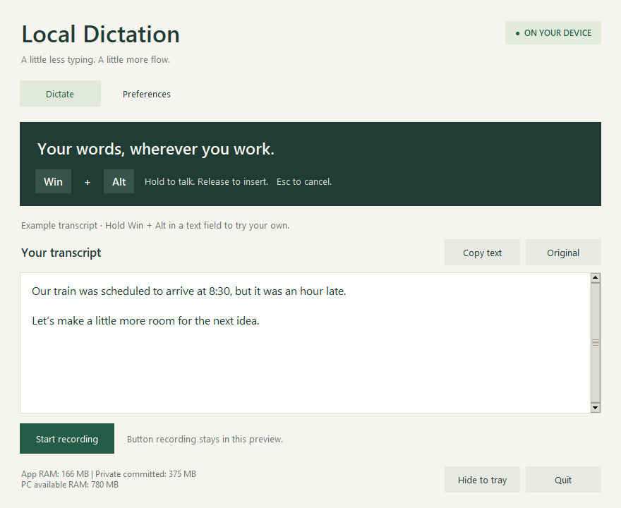

# Local Dictation

Offline English speech-to-text for Windows. Hold **Win + Alt**, speak, and release
to insert text into your active text field. Recognition and punctuation run on
your CPU, with no account or paid API.



## Download

Get `LocalDictation-Setup.exe` from [GitHub Releases](https://github.com/abbasgabol/Flowscribe-Speech-to-text-AI/releases).
The installer includes Python, dependencies, and models. Choose your destination
drive, model components, and shortcuts. Once downloaded, setup works offline.

- Windows 10/11 x64 and a microphone required.
- Start with 8 GB RAM and 2 GB free storage; performance varies by PC.
- Choose Lightweight for lower resource use, or Complete to add Accuracy.
- This beta is unsigned; Windows may display an unknown-publisher warning.

## Features

Hold-to-talk dictation, an editable preview, local punctuation, spacing repair,
clock-phrase formatting, a personal dictionary, original-transcript inspection,
model selection, memory monitoring, and system tray controls.

Recognition can be wrong. Review important text. Full grammar rewriting and
automatic model training are not implemented.

## Run from source

Use Windows and Python 3.10 or 3.11 (64-bit). From the repository root:

```powershell
.\scripts\setup.bat
.\run.bat
```

Setup downloads dependencies and the lightweight speech/punctuation models.
Run `scripts\setup_accuracy.bat` to add the larger model. You can also launch with:

```powershell
.\.venv\Scripts\python.exe -m local_dictation
```

## Repository layout

```text
local_dictation/   Runtime package: UI, recognition, input, text processing
scripts/          Setup, downloads, benchmarks, builds, verification
tests/           Automated tests
assets/           Desktop icon
docs/            Architecture, source guide, third-party notices
packaging/        Windows installer, artwork, licenses, release notes
website/          Static website and deployment configuration
run.bat           Convenient Windows source launcher
```

Models, environments, build outputs, and personal settings are ignored by Git.
The website stays at `website/dist` for the existing Vercel deployment. Large
installers are release assets, not files committed to Git.

## Development

```powershell
.\.venv\Scripts\python.exe -m unittest discover -s tests
.\.venv\Scripts\python.exe scripts/verify.py base.en
```

Read [Contributing](CONTRIBUTING.md), [architecture and logic](docs/ARCHITECTURE.md),
and [release publishing](packaging/PUBLISHING.md) for setup and build instructions.

## Privacy and storage

Audio stays in memory and is processed locally. Only corrections you explicitly
save are remembered. Installed preferences live in `%LOCALAPPDATA%\LocalDictation`;
source-mode preferences stay in the repository root. Models remain in the chosen
installation folder or the repository's `models/` folder. Uninstalling preserves
preferences; delete the data folder separately if desired.

## License

[MIT](LICENSE). Dependencies and models retain their own licenses; see
[third-party notices](docs/THIRD-PARTY-NOTICES.md) and `packaging/licenses`.
